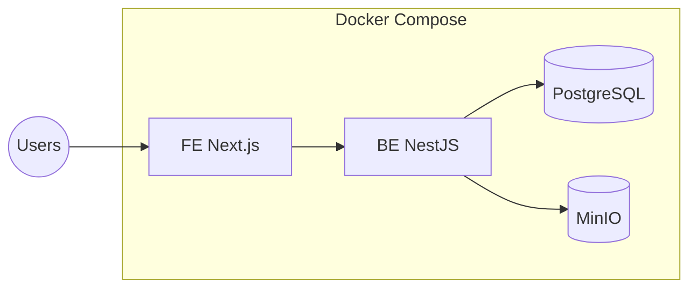
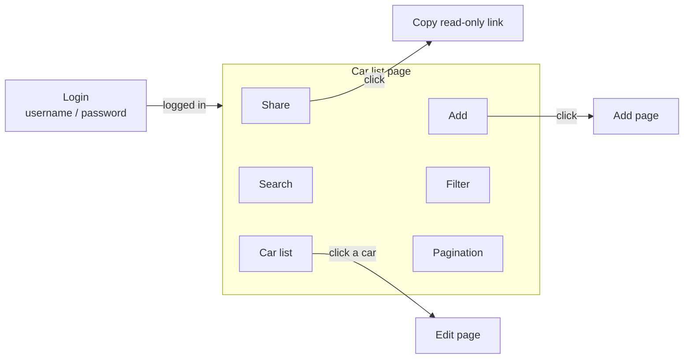

# Haupcar Car Records

A small website for Somchai's team to record company cars, so the data no longer lives in a notebook.

## Features

- **Login**: Somchai signs in with one fixed username/password
- **Add car**: registration no., brand, model, notes
- **View all cars**: a list with search, filter and pagination
- **Edit car**: click a car in the list to open its edit page
- **Delete car**
- **Share**: copy a read-only link so the team can view the data

## Tech Stack

| Part | Tech |
|---|---|
| Frontend | Next.js + shadcn/ui |
| Backend | NestJS |
| Database | PostgreSQL |
| Object storage | MinIO (S3 API) |
| Tooling | Docker Compose |

## Components



## Flow



## Getting Started

```bash
docker compose up -d --build
```

| Service | URL |
|---|---|
| Web app | http://localhost:3000 |
| API | http://localhost:4000/api/v1 |
| API docs (Swagger) | http://localhost:4000/api/docs |
| Health | http://localhost:4000/health |
| MinIO console | http://localhost:9001 (`minioadmin` / `minioadmin`) |

Needs only Docker. The first build takes a few minutes. Database migrations run automatically when the backend starts.

### Login

| Username | Password |
|---|---|
| `somchai` | `haupcar1234` |

The credentials are local-demo values set in [`docker-compose.yml`](docker-compose.yml) (`AUTH_USERNAME` / `AUTH_PASSWORD`). Change them there, then run `docker compose up -d` again.

### Sample data (optional)

The app starts empty. To add 8 sample cars:

```bash
docker compose exec backend node dist/database/seeds/seed.js
```

Safe to run again: cars that already exist are skipped.

### Stop / reset

```bash
docker compose down      # stop, keep data
docker compose down -v   # stop and delete all data (database + images)
```

## How to Use

1. **Log in**: open http://localhost:3000 and sign in with the account above.
2. **Find a car** (car list):
   - Type in the search box to find a plate, brand or model. Results update as you type.
   - Filter by brand, or change the sort order (newest, oldest, plate, brand, year).
   - Browse 10 cars per page. Search and page live in the URL, so refresh and back keep your place.
3. **Add a car**:
   - Click **เพิ่มรถ**.
   - Fill in plate, province, brand and model. Year, color, notes and photos are optional.
   - Click **บันทึก**.
4. **Edit a car**:
   - Click a row to open its edit page.
   - Change the fields and click **บันทึก**.
   - Photos save immediately when you add or remove them.
5. **Delete a car**: on the edit page, click **ลบรถ** and confirm.
6. **Share with the team**:
   - Click **แชร์**, then **คัดลอกลิงก์**.
   - Anyone with the link can search and view cars, including photos and notes, without logging in. They cannot change anything.
   - **สร้างลิงก์ใหม่** replaces the link. The old one stops working at once.

## Extras Beyond the Requirement

- **Car photos**: up to 10 per car (JPEG/PNG/WebP, max 5 MB each), stored in MinIO. The first photo is the list thumbnail.
- **More car fields**: province, year and color.
- **Thai plate rules**:
  - The plate is checked and normalised (`1กข-1234` → `1กข 1234`).
  - The same plate cannot be added twice in one province.
- **Read-only share page** with a car detail view and a photo viewer. The link can be revoked.
- **UI states**: every screen has loading, empty, no-match, error-with-retry and success feedback. The layout works on mobile (cards instead of a table).
- **API docs** (Swagger) and automatic DB migrations.
- **Tests**:
  - Backend unit tests (`cd backend && npm install && npm test`).
  - Backend e2e tests (`npm run test:e2e`). These need their own Postgres database and env.
  - Frontend schema tests (`cd frontend && npm install && npm test`).

## Remark

I designed the scope, architecture and all coding conventions in [`docs/conventions/`](docs/conventions/) myself, and I can explain every part of the code. AI (Claude) helped write code because time was short, but it follows my conventions, so the code stays consistent with my own style.
