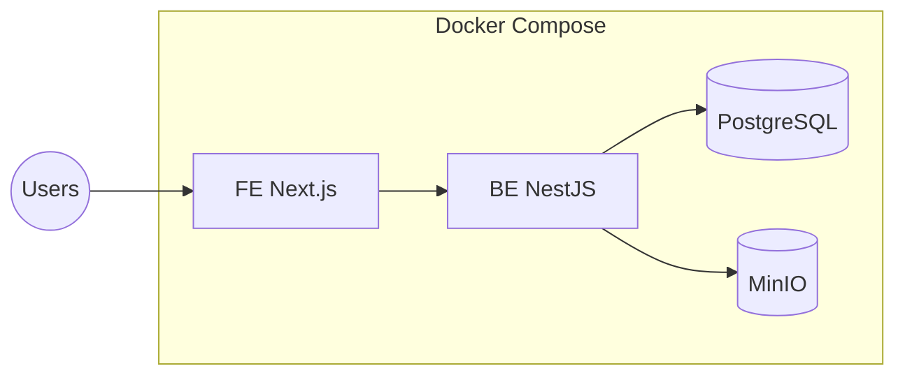
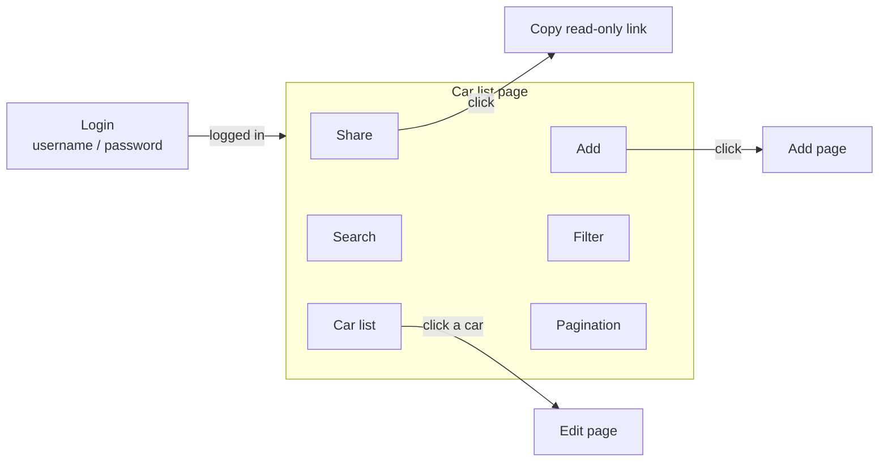

# Haupcar Car Records

A small website for Somchai's team to record company cars, so the data no longer lives in a notebook.

## Features

- **Login**: Somchai signs in with one fixed username/password
- **Add car**: registration no., brand, model, notes
- **View all cars**: a list with search, filter and pagination
- **Edit car**: click a car in the list to open its edit page
- **Delete car**
- **Share**: copy a read-only link so the team can view the data

## Tech Stack

| Part | Tech |
|---|---|
| Frontend | Next.js + shadcn/ui |
| Backend | NestJS |
| Database | PostgreSQL |
| Object storage | MinIO (S3 API) |
| Tooling | Docker Compose |

## Components



## Flow



## Getting Started

```bash
docker compose up -d --build
```

## Remark

I designed the scope, architecture and all coding conventions in [`docs/conventions/`](docs/conventions/) myself, and I can explain every part of the code. AI (Claude) helped write code because time was short, but it follows my conventions, so the code stays consistent with my own style.
