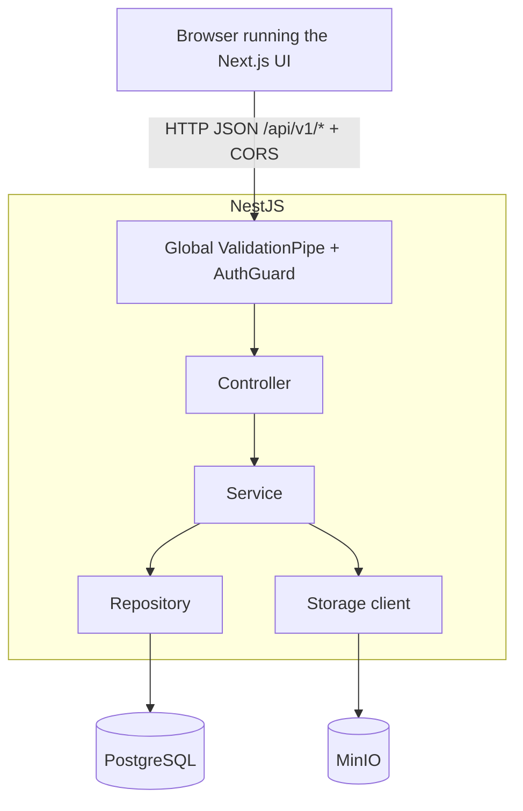

# 01 — Architecture

> **When to read:** Once per session. Every other rule rests on this.

## 1. Architecture baseline

1. **One** NestJS service (a modular monolith), not microservices.
2. A Nest module is a **business capability**, not a table or a technical layer.
3. PostgreSQL via TypeORM in Data Mapper style, with module-owned repository classes (§9.3).
4. Car images live in MinIO (S3-compatible). PostgreSQL stores only the object key (§10).
5. Express adapter, Node.js 24 LTS, CommonJS output.
6. Every route lives under `/api/v1`. All business data goes through this API; the frontend never touches the DB or MinIO credentials ([ADR-0004](../../adr/0004-frontend-nextjs.md)).
7. Auth uses fixed credentials, with no user table ([ADR-0009](../../adr/0009-auth-fixed-credentials.md)), and a JWT bearer token ([ADR-0011](../../adr/0011-auth-jwt-bearer-localstorage.md), §6).
8. Out of scope: event bus, queue, cache, GraphQL, WebSockets, rate limiting, multi-tenant.

### 1.1 Expected modules

| Module | Owns |
|---|---|
| `cars` | Car records, including their image keys |
| `auth` | Login with fixed credentials, the auth guard |
| `health` | `GET /health` for Docker healthchecks (controller → service → DB ping) |

Full file-level tree: [`plan/project-structure.md`](../../plan/project-structure.md).

Add a module only when a new capability appears in an approved spec.

### 1.2 Request flow

The browser calls Nest **directly**; Next.js does not proxy data ([ADR-0010](../../adr/0010-browser-calls-api-directly.md)). CORS is therefore required (§12).
